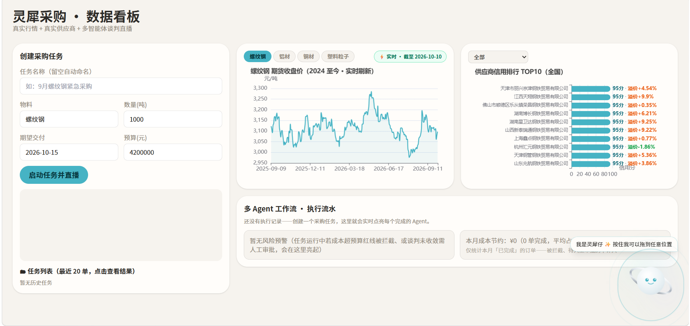
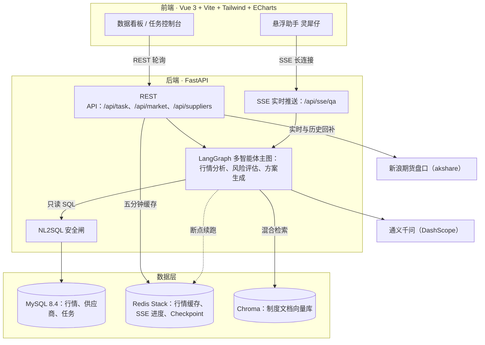

<div align="center">

# 🪐 灵犀采购 LingXi-procurement

**真实行情 · 真实供应商 · 多智能体执行直播的大宗商品供应链采购谈判系统**

以 LLM 多智能体流水线重构「行情研判、风险控制、价格谈判」的采购决策链路

[](https://www.python.org/)
[](https://fastapi.tiangolo.com/)
[](https://www.langchain.com/langgraph)
[](https://vuejs.org/)
[](https://www.mysql.com/)
[](https://redis.io/)
[](https://docs.docker.com/compose/)

</div>

---

## 📸 项目预览



> 数据看板：期货实时行情 60 秒轮询刷新、供应商信用 TOP10 排行、多 Agent 执行流水直播；右下角为可拖拽的对话式悬浮助手「灵犀仔」。行情取自期货主力连续合约（数据源：新浪财经），与各地现货报价存在基差属正常现象。

## 💡 项目简介

大宗商品采购是企业里最典型的「看行情、控风险、谈价格」场景。本项目把它做成一条由 LLM 多智能体驱动的决策流水线：在前端创建采购任务后，多个 Agent 在后端 LangGraph 图中接力执行，过程通过 SSE 实时直播到看板；行情接的是新浪期货真实盘口，供应商是含工商档案的真实数据，RAG 问答全部附带溯源来源卡片。

**三个关键词：真实数据、过程透明、结论可溯源。**

### 🎯 项目价值与结果

**业务价值**

- 将采购决策从人工翻查报表、电话询价与经验判断，收敛为一屏可视化的决策流水线：行情走势、供应商信用、风险预警、优化方案同屏呈现
- 采购任务的执行过程全程留痕、结果附带溯源卡片，决策依据可审计、可复盘，而非黑盒结论
- 风险 Agent 在任务执行过程中对成本超预算、交付逾期等红线实时拦截，异常场景自动转入人工审批

**可验证的结果**

- ✅ 全链路贯通：创建采购任务 → 多 Agent 接力执行 → SSE 实时推送 → 生成含风险预警与优化建议的采购方案
- ✅ 数据真实可信：2,359 条期货历史行情、80 家含工商档案的真实供应商，均来自公开渠道，无人工构造数据
- ✅ 检索结论可溯源：Chroma 向量检索与 BM25 关键词检索双路召回、RRF 融合排序，每条回答均标注制度文档出处
- ✅ 质量保障完备：unit / integration / e2e 三层测试共 61 个用例全部通过（含真实 LLM 的端到端链路）
- ✅ 部署可复现：Docker Compose 一键启动 4 个服务，执行三条初始化命令后即可完整运行

## ✨ 核心功能

| 模块 | 说明 |
| --- | --- |
| 🤖 多智能体任务流水 | 创建采购任务后，行情分析、风险评估、方案生成等 Agent 依次接力，执行过程经 SSE 实时直播到看板 |
| 📈 实时行情 | 新浪期货盘口（螺纹钢 / 铝材 / 铜材 / 塑料粒子），历史日线自动幂等回补，Redis 5 分钟缓存，60 秒轮询 |
| 🏭 供应商库 | 80 家真实供应商（含工商档案回填），按注册地、主营品类筛选，信用评分 TOP10 可视化 |
| 🔍 混合检索 RAG | Chroma 向量检索 + BM25 关键词检索，RRF 排名融合，回答附带溯源来源卡片 |
| 🛡️ NL2SQL 安全闸 | 自然语言查库前经 SQL 校验器拦截高危语句（DROP / UPDATE / DELETE 等），仅放行只读查询 |
| ✨ 悬浮助手「灵犀仔」 | SSE 流式问答、打字机逐字输出、溯源卡片、自由拖拽 + 位置记忆、四角拖拽调节窗口大小 |

## 🏗️ 架构图



## 🧰 技术栈

| 层 | 技术 |
| --- | --- |
| 前端 | Vue 3 · Vite · Tailwind CSS · ECharts · 原生 EventSource（SSE） |
| 后端 | Python 3.14 · FastAPI · uvicorn · sse-starlette |
| 智能体编排 | LangGraph（主图 + Redis Checkpoint 断点续跑）· LangChain · 通义千问（DashScope） |
| 数据 | MySQL 8.4（SQLAlchemy + PyMySQL）· Redis Stack（RediSearch）· ChromaDB |
| 检索 | jieba 分词 · rank-bm25 · RRF 排名融合 |
| 数据采集 | akshare（新浪期货实时盘口与历史日线） |
| 测试 | pytest（unit / integration / e2e 分层，共 61 个用例） |
| 部署 | Docker Compose 一键编排 4 个服务 |

## 🚀 快速启动

> 前置：安装 Docker Desktop（或任意 Docker + Compose v2）；到[阿里云百炼](https://bailian.console.aliyun.com/)申请一个 `DASHSCOPE_API_KEY`。

```bash
# 1. 克隆 + 配置
git clone https://github.com/<你的用户名>/lingxi-procurement.git
cd lingxi-procure
cp .env.example .env          # 填入你的 DASHSCOPE_API_KEY，其余默认即可

# 2. 一键构建并启动 4 个服务（MySQL + Redis Stack + 后端 + 前端）
docker compose up --build -d

# 3. 首次初始化（三条一次性命令：建表 → 导种子数据 → 建向量知识库）
docker compose exec backend python init_db.py
docker compose exec backend python -m src.data.import_csv
docker compose exec backend python -m src.rag.build_kb
```

然后打开：

| 地址 | 内容 |
| --- | --- |
| http://localhost:5174 | 数据看板（前端） |
| http://localhost:8001/docs | 后端接口文档（Swagger） |
| http://localhost:8001/health | 健康检查 |

<details>
<summary><b>本地部署（不使用 Docker）</b>（点击展开）</summary>

```bash
# 准备：Python 3.12+、MySQL、Redis Stack
pip install -r requirements.txt
cp .env.example .env                        # 修改 DB_HOST / REDIS_URL 等为本机地址

python init_db.py
python -m src.data.import_csv
python -m src.rag.build_kb

uvicorn src.api.main:app --host 0.0.0.0 --port 8001    # 后端

cd frontend
npm install
npm run dev                                            # 前端（Vite 默认 5173）
```

</details>

## 📂 项目结构

```
lingxi-procurement/
├── src/
│   ├── api/            # FastAPI 路由：任务 / SSE / 看板数据
│   ├── graph/          # LangGraph 多智能体主图与状态定义
│   ├── rag/            # 混合检索、NL2SQL、知识库构建
│   ├── core/           # 参数校验器、SQL 安全闸、任务编排
│   ├── data/           # 行情接入（akshare）、CSV 导入
│   ├── db/             # SQLAlchemy 模型与会话
│   └── utils/          # LLM 客户端、配置、日志
├── frontend/           # Vue 3 看板 + 灵犀仔悬浮助手
├── tests/              # unit / integration / e2e 三层测试
├── seed_data/          # 种子数据：行情 CSV、供应商 CSV、制度文档
├── docs/               # 设计文档与截图
├── PRD.md              # 产品需求文档
├── TECH_SPEC.md        # 技术规格说明
└── docker-compose.yml  # 一键编排：MySQL + Redis Stack + 后端 + 前端
```

## 🧪 测试

```bash
pytest -m unit           # 单元测试
pytest -m integration    # 集成测试
pytest -m e2e            # 端到端（需启动后端并配置真实 API Key）
pytest                   # 全量 61 个用例
```

## ⚠️ 声明

本项目为个人学习与技术展示用途，行情与供应商数据来自公开渠道，不构成任何采购或投资建议。

---

<div align="center">

**如果这个项目对您有所帮助，欢迎点亮 Star 支持**

</div>
